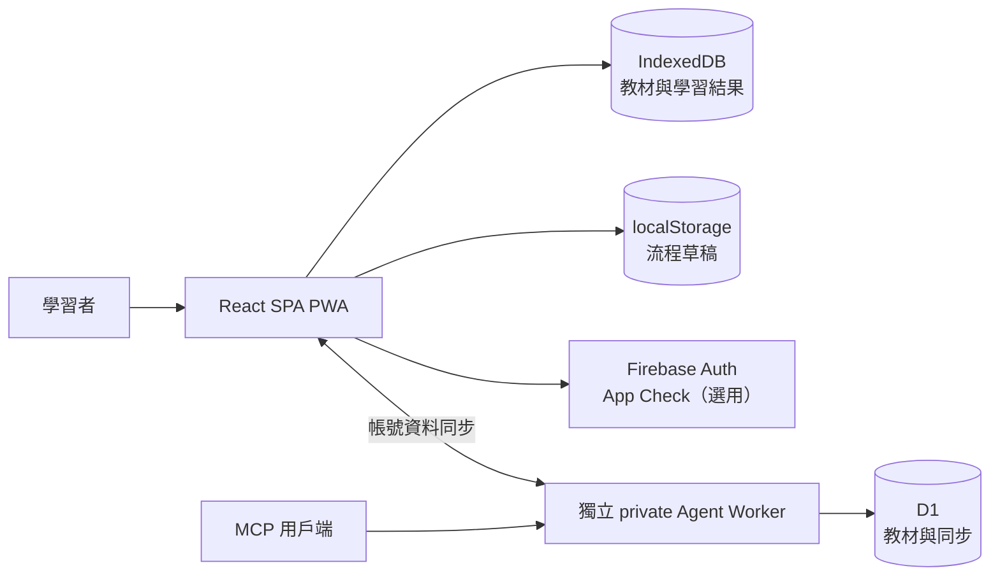

# Lexiro

Lexiro 是個人英文單字學習 PWA。把文字、照片或手動輸入整理成單字與詞義後，可以練習中文詞義選擇、拼字與學測題型。教材先保存在本機；登入後可同步到其他裝置。

## 問題與目標

同一個單字可能出現在不同教材，也可能有多個詞義。如果每個單字集各保存一份，修改例句就會互相分離。Lexiro 以詞義作為共享單位：單字集保存收錄關係，題目都指向相同的 `SenseId`。

## 核心功能

- 教材：巢狀資料夾、單字集、詞義與例句編輯、搜尋、移動、匯入與分享。
- 擷取：手動輸入，或由 MCP 寫入教材，再在網站編輯與整理。
- 練習：本機四選一詞義題、拼字、詞彙、文法、克漏字、文意選填、篇章結構與閱讀。
- 複習：錯誤重練、標記項目與中斷接續。
- 資料：IndexedDB 保存、帳號隔離、D1 同步、完整 ZIP 備份。
- PWA：可安裝、離線教材與練習、亮暗色，以及保存後才接管新版的更新流程。

AI 直接生成功能已封存於分支 `archive/managed-ai`，教材內容目前由 MCP 寫入。

## 系統架構



教材和題目由 browser domain 處理；D1 是帳號資料的遠端副本。獨立的 private Agent Worker 提供 MCP 寫入與同步，不呼叫模型供應商。公開前端的 `packages/agent-contract` 保存 MCP 寫入契約，`packages/ai-contract` 只保留題型、字數與共用格式。

一次練習的答案會先保存學習資料，再推進畫面。教材異動由 browser domain 保存；MCP 寫入經 Agent Worker 驗證後進 D1。完整時序見[架構](docs/architecture.md)、[資料與同步](docs/data-and-sync.md)及[Agent 批次寫入](docs/agent-validation.md)。

## 技術棧

| 層級 | 技術 | 用途 |
| --- | --- | --- |
| Web | Vite 8、React 19.2、React Router 8、TypeScript 7 | 純前端 SPA，各畫面 lazy route 分開載入 |
| UI | Tailwind CSS 4、Radix UI、Motion、HarmonyOS Sans TC | 元件、字型、亮暗色與動態 |
| State / forms | Zustand、TanStack Query、React Hook Form、Zod | Domain state、查詢與輸入 |
| 保存 | idb-keyval | IndexedDB |
| 帳號／同步 | Firebase Auth、App Check（選用）、D1 | Google 登入、帳號資料與 attestation |
| Agent backend | Cloudflare Workers、D1 | MCP 寫入與帳號資料同步 |
| 離線／備份 | Serwist 9、fflate | App 資產快取與 ZIP 備份 |
| 驗證 | Vitest 4、Testing Library、Oxlint | 單元／元件檢查及 client boundary |

固定依賴在 `package-lock.json`，Agent backend 有自己的 lockfile 和部署流程。

## 快速開始

使用 Node.js 24，與 GitHub Actions 一致。在 PowerShell 7 執行：

```powershell
npm ci
npm run dev
```

開啟 `http://localhost:3000/app`。根路徑 `/` 會直接轉址到 `/app`。純本機模式不設定 Firebase；要開啟登入同步才複製 `.env.example` 到 `.env.local` 並填真實值。登入同步與 MCP 需要運作中的 Agent Worker 和已登入帳號。離線功能用 production build（`npm run build && npm run start`）與 Service Worker 驗證，`npm run dev` 不註冊它。

```powershell
npm run typecheck
npm run lint
npm run test
npm run build
```

`build` 的 postbuild 會檢查 client bundle 是否含 private prompt 指紋。本機檢查不呼叫外部服務，詳細流程見[本機開發](docs/local-development.md)與[測試](docs/testing.md)。

## 文件

- [文件索引](docs/README.md)
- [產品與操作](docs/product.md)
- [路由、帳號與權限](docs/routes-and-permissions.md)
- [系統架構](docs/architecture.md)
- [資料模型、保存與同步](docs/data-and-sync.md)
- [練習](docs/practice.md)
- [Agent 使用說明](docs/agent-access.md)
- [設定參考](docs/configuration.md)
- [本機開發](docs/local-development.md)
- [部署](docs/deployment.md)
- [測試與驗證](docs/testing.md)
- [文件與流程地圖維護](docs/documentation-maintenance.md)
- [程式責任索引](structure.md)
- [離線程式流程地圖](tools/project-map/README.md)

執行 `node tools/project-map/build.mjs` 產生桌面的 `Lexiro-程式流程地圖.html`，內嵌公開原碼、資料形狀與流程；Worker 只提供核對後的 schema／排程／版本 metadata。成品可離線閱讀，更新程式後重新產生。

## 現行邊界

同步、MCP 和登入都需要網路。瀏覽器儲存空間可能被清除，備份仍由使用者匯出保管。本機詞義題需要三個不同且不與目標詞義重疊的干擾答案；不足時略過該題。MCP 的結構驗證不能證明語意、辨識與教學品質，寫入內容仍可在網站校對。

Agent Worker 只依 Firebase ID token 與授權範圍存取帳號資料，前端不持有供應商金鑰。D1 schema、備份、練習快照與 Agent contract 各有自己的版號，更新時依[資料文件](docs/data-and-sync.md)處理。
