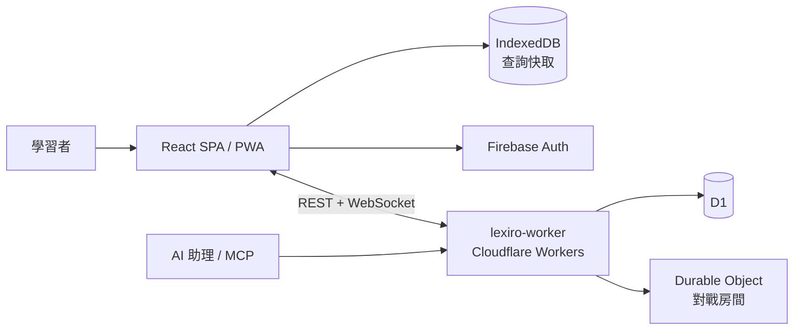

# Lexiro

Lexiro 是個人英文單字學習 PWA。單字、詞義與題目存在帳號裡，可以在網頁整理，也可以讓 AI 助理透過 MCP 寫入，再用各種題型練習、和朋友即時對戰。

## 功能

- **單字庫**：資料夾、單字集、單字與多個詞義、批次貼上新增、搬移與複製、標星、分享連結。
- **題目**：詞彙、克漏字、文意選填、篇章結構、閱讀測驗，由 MCP 寫入後在網頁預覽與刪除。
- **練習**：選單字集與題型組一輪；詞義、反向、各類題目；即時解析與「為什麼錯」；中斷可接續，結束後可重練錯題。
- **今天與進度**：每日目標、連續天數、熱度圖、熟悉度分布與各題型正確率。
- **對戰**：開房間、用代碼加入，最多 8 人同題比快比準，結束後看自己錯的題。
- **我**：帳號、偏好（主題、每輪題數）、資料匯出／匯入、AI 助理連線管理、關於與更新、管理員頁面。
- **PWA**：可安裝；離線時可瀏覽教材，練習答案在本機排隊，連線後送出。

## 架構



前端只透過 Worker 的 REST API 讀寫資料，對戰房間走 WebSocket。資料格式定義在 `packages/contract`，Worker 保有同一份複本。

## 技術棧

| 層級 | 技術 |
| --- | --- |
| Web | Vite 8、React 19、React Router 8、TypeScript |
| UI | `packages/design-kit`、Tailwind CSS 4、Phosphor Icons、sonner |
| 資料 | TanStack Query（IndexedDB 持久化）、zod contract |
| 帳號 | Firebase Auth（Google）、App Check（選用） |
| 離線 | Serwist |
| 檢查 | Vitest、Oxlint |

## 開發

```sh
cp .env.example .env.local   # 填入 Firebase 與 Worker 網址
npm ci
npm run dev
```

提交前執行 `npm run typecheck && npm run lint && npm test && npm run build`。
